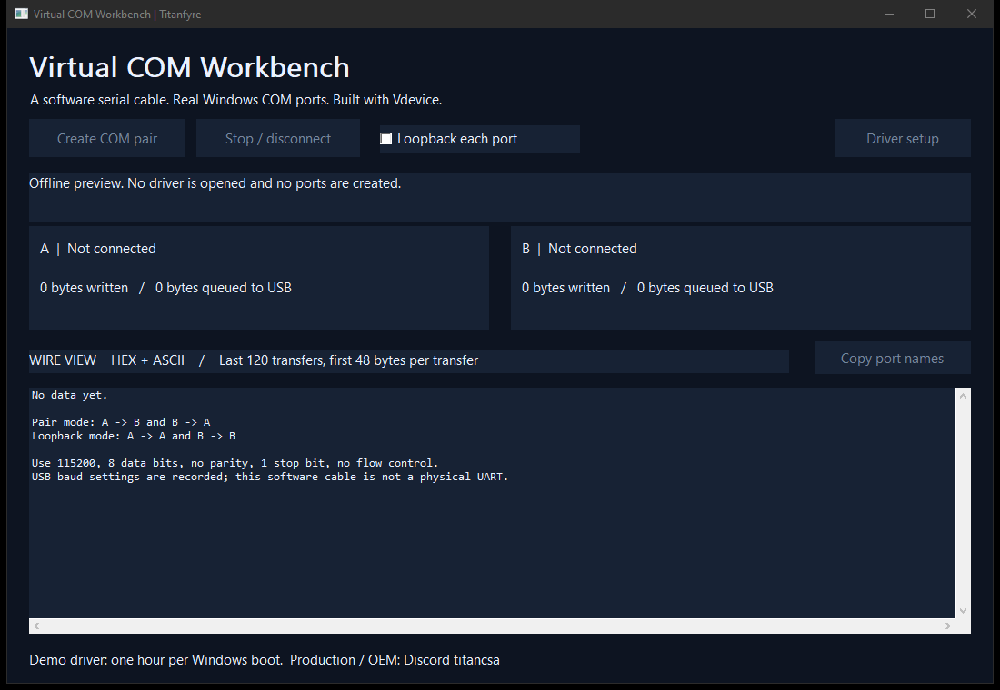

# Virtual COM Workbench

> **Engineering preview: live COM transport is not validated.** Offline protocol and memory checks pass, but a disposable Windows 10 VM selected `usbser.sys` and then stalled during device startup. No successful serial transfer was verified, and guest shutdown also stalled. Usable application/driver release binaries are withheld while the backend is investigated. Do not deploy this preview on a production PC.

**Create a virtual serial cable for Windows software, without a physical serial adapter.** Two USB CDC ACM devices become ordinary Windows COM ports through Microsoft's inbox `usbser.sys` driver. Bytes written to A arrive at B, and bytes written to B arrive at A. Switch to loopback to echo each port's own writes.

[Source preview](https://github.com/titanfyre/Virtual-COM-Workbench) · [Vdevice driver](https://github.com/TitanCSA/Vdevice) · **Production / OEM: add `titancsa` on Discord**



Useful for testing serial applications, connecting two local programs, checking binary protocols, and demonstrating USB CDC behavior. Applications can use Win32 serial APIs, .NET SerialPort, Python pyserial, or a terminal. No physical COM port is opened or modified by this tool.

## Install and connect

The following workflow is the intended interface after live transport is fixed and verified. No ready-to-install release is available yet.

1. Download and extract the complete Windows release ZIP.
2. Run `Dependencies/VdeviceSetup.exe`, choose **Install / reinstall**, and restart Windows if requested. This installs the existing Microsoft-signed Vdevice demo driver. Test signing is not required.
3. Open `VirtualCOMWorkbench.exe` and click **Create COM pair**. Windows asks for administrator approval for live device creation.
4. Wait for the **A** and **B** cards to show their COM names. Open A in the first serial application and B in the second. Use **115200, 8N1, no flow control** to start.
5. Send data from either application. The wire view shows hex and ASCII; the two cards show received bytes and bytes queued back to Windows.

**Stop / disconnect** or closing the app removes both owned virtual USB devices. Stop before changing between cable and loopback mode. Port names are assigned by Windows and can change when a fresh pair is created; **Copy port names** avoids guessing. Windows may retain hidden Plug and Play records after removal, as it does for unplugged USB equipment.

The app does not open the two COM ports during normal routing, so your own programs can own them. The built-in diagnostic opens only its own newly created pair.

## Automated binary diagnostic

In an administrator console on a test PC or VM:

```powershell
.\VirtualCOMWorkbenchCLI.exe --smoke-test "$PWD\serial-result.json"
```

The diagnostic creates a fresh pair, discovers its COM ports by **exact unique USB serial ancestry**, sends and verifies 4,096 binary bytes in each direction, closes the client handles, and removes the pair. The JSON report records success or the exact failure. It never chooses an arbitrary existing COM port. Its elapsed time covers application-level serial transfers; it is not a physical UART or end-to-end equipment latency measurement.

Offline modes open no driver and create no devices:

```powershell
.\VirtualCOMWorkbenchCLI.exe --self-test
.\VirtualCOMWorkbench.exe --preview
```

## Protocol and boundaries

The virtual devices implement one full-speed CDC ACM function each: communication interface 0, data interface 1, interrupt notification endpoint `81`, and bulk endpoints `82` / `02`. Windows installs `usbser.sys` from its own driver store; no extra serial-device INF is supplied.

`GET_LINE_CODING`, `SET_LINE_CODING`, `SET_CONTROL_LINE_STATE`, and `SEND_BREAK` are validated and handled. Baud rate, parity, stop bits and break requests are recorded as software state. DSR/DCD notifications follow the local DTR state. This is a byte cable: it does not simulate electrical RS-232 levels, baud-dependent wire timing, every modem signal, vendor-specific UART controls, or hardware RTS/CTS flow control. Use **no flow control**. Unrecognized requests are stalled.

Each direction has a bounded 64 KiB application queue. Downstream backpressure is retried; an overrun stops the pair with a clear error instead of silently discarding data. The on-screen log is limited to 120 transfers and a 48-byte preview per transfer. Counters distinguish writes received from data accepted into the USB input queue; acceptance is not proof that the target application consumed the bytes. No network service or telemetry is added.

The source uses the local test identity `FFFF:CDC1` with a unique serial for each device. It does not claim ownership of an allocated USB-IF vendor ID. Arrange your own identities and compatibility validation for an OEM product.

## Build

Windows 10/11 x64, Visual Studio 2022 **Desktop development with C++**, Windows SDK and CMake:

```powershell
.\Build.ps1
.\Build.ps1 -AddressSanitizer
```

Outputs are in `obj/Build/bin/`. The project is C++17 with a native Win32 interface and no downloaded build dependency. The unchanged Vdevice user-mode SDK is included in `SDK/`; kernel source is not included.

`App/Cdc.cpp` contains the descriptor/control model, `App/Session.cpp` owns routing and cleanup, and `App/Main.cpp` contains the UI and CLI entry points. Offline checks cover descriptor validation, strict controls, queue limits, byte preservation and 10,000 varied binary FIFO cycles. See [validation scope](docs/VALIDATION.md).

## Demo and production

The public app and included user-mode SDK sources use the [MIT license](LICENSE). The prebuilt Vdevice driver has [separate binary terms](docs/BINARY-LICENSE.txt). Its shared demo allowance is **one hour per Windows kernel boot**, starting with the first virtual-device creation. Expiry disconnects devices and requires Windows **Restart** for a new allowance.

A ready-to-deploy serial cable is not yet available. For a scoped integration discussion, add **`titancsa` on Discord** and mention **Virtual COM Workbench**. Removing an application check or rebuilding the public app does not remove the kernel demo limit. Production builds and activation keys are delivered privately.

Microsoft's signature applies to the supplied driver package. It does not imply Microsoft endorsement, sign this application, or guarantee every serial program will work. Validate the actual applications and Windows versions in your deployment.

## Responsible use

This project is for lawful development, testing and integration on systems you own or are authorized to use. You are responsible for your use of the application, SDK and driver, including any illegal activity or damage. The software is supplied without warranty; see the licenses for the applicable terms.

Protocol references: [Microsoft USB serial driver installation](https://learn.microsoft.com/en-us/windows-hardware/drivers/usbcon/usb-driver-installation-based-on-compatible-ids) and the [USB-IF CDC specifications](https://www.usb.org/documents?search=CDC).
